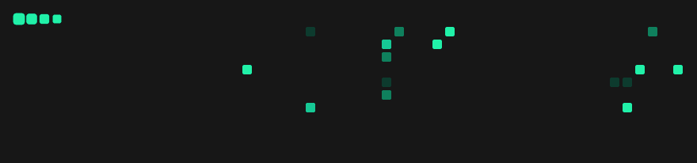

# 👨‍💻 Ammar Yaser Alsalahi

  

  
  
  

  <b>Full-Stack Mobile Developer</b> · Flutter · Laravel · PHP

---

## -- About Me

I'm an IT graduate and Full-Stack Mobile Developer passionate about designing and building modern, scalable, and user-friendly digital products.

I specialize in cross-platform mobile development using **Flutter and Dart**, alongside backend development using **Laravel and PHP**.

I enjoy working across the entire development lifecycle, from building intuitive mobile interfaces to designing backend systems, databases, and RESTful APIs.

-  Developing cross-platform mobile applications with Flutter.
-  Building backend systems and RESTful APIs with Laravel.
-  Working with MySQL, Firebase, and Supabase.
-  Writing clean, maintainable, and scalable code.
-  Building applications with practical, real-world use cases.
-  Continuously learning and improving my development skills.

---

##  Tech Stack

### 📱 Mobile Development

  

### -- Backend & Database

  

### -- Tools & Technologies

  

---

## - Featured Projects

### - 1. Sakina — Islamic Lifestyle & Dhikr App

A modern Islamic mobile application designed to help users maintain their daily worship and stay connected with their spiritual routines.

**Built with:** Flutter · Dart

**Key Features:**
- - Daily Adhkar and Hadith.
- - Prayer Times and Qibla Direction.
- - Quran-related features and Islamic content.
- - Smart reminders and scheduled notifications.
- - Worship tracking and personal statistics.
- - Quran Khatma planning and progress tracking.
- - Multiple themes and Arabic/English support.
- - Offline-first experience for essential features.

  

---

### - 2. TaqsitApp — Smart Installment Platform

A full-stack e-commerce and installment platform built with Flutter and Laravel.

**Built with:** Flutter · Laravel · PHP · MySQL

**Key Features:**
- - Customer mobile application.
- - Laravel backend and RESTful APIs.
- - Installment and payment workflows.
- - Database-driven business logic.

  

---

### - 3. MOTORA — Car Showroom Platform

A modern car showroom application built with Flutter and Supabase.

**Built with:** Flutter · Dart · Supabase

**Key Features:**
- - Car discovery and browsing.
- - Dealership management.
- - Favorites and inquiries.
- - Arabic and English localization.

---

### - 4. Full-Stack E-Commerce Graduation Project

A full-stack e-commerce mobile application developed as a graduation project using Flutter and Laravel.

**Built with:** Flutter · Laravel · PHP

  

---

### - 5. Quran & Azkar App

An offline-first Islamic application focused on accessibility and a simple user experience.

**Built with:** Flutter · Dart

**Key Features:**
- - Quran browsing.
- - Daily Azkar.
- - Local data storage.
- - Offline accessibility.

  

---

## - GitHub Analytics

  
  

  

---

##-- Contribution Activity

  

---

## - Let's Connect

  
  
  

  

  <b>Building meaningful software, one commit at a time. 💚</b>

